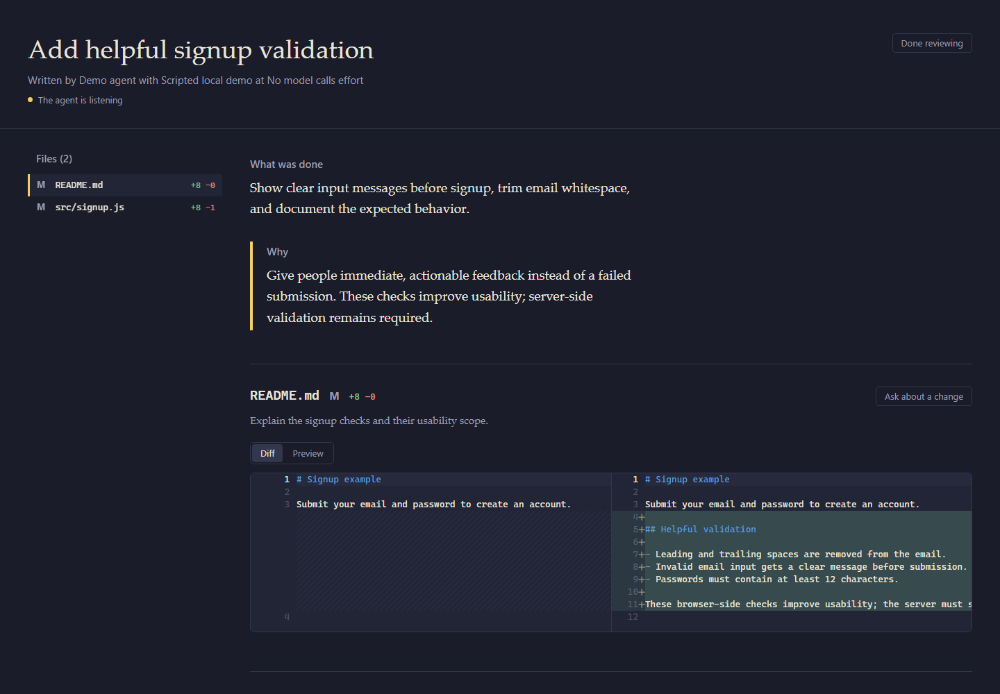
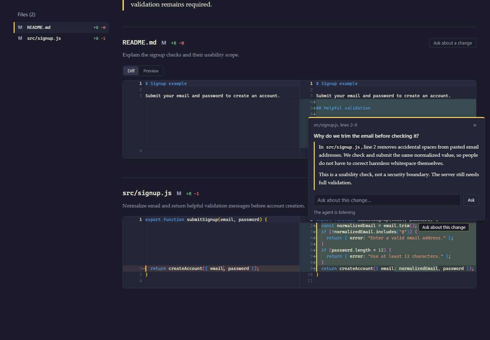
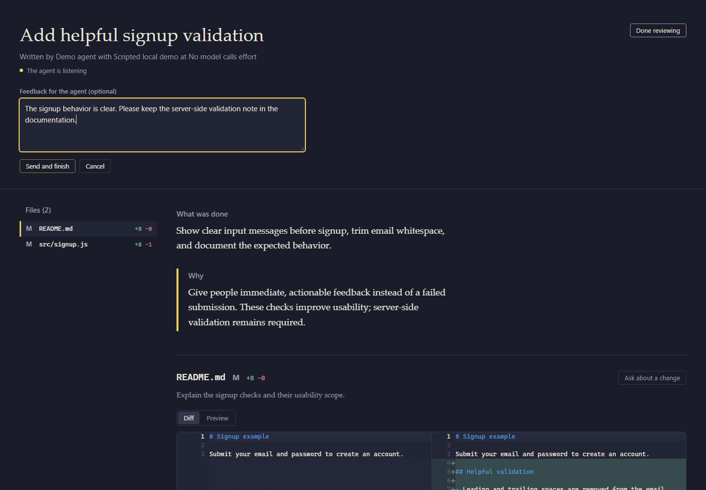

# DiffChecker

[English](README.md) | **日本語**

AI が書いたコードを承認する前に、**「何を、なぜ変更したか」**と差分を確認し、
気になる変更について実装したエージェントに質問できるツールです。
Node.js の CLI とローカルのブラウザー画面で動作します。ホスティング型サービスではありません。

## 目次

- [1. はじめに：必要なもの](#requirements)
- [2. 初回セットアップ](#setup)
- [3. 最初のレビューを始める](#first-review)
- [4. 画面の使い方：スクリーンショット付き](#visual-guide)
- [5. 困ったとき](#troubleshooting)
- [6. 詳細設定・手動操作](#advanced)
- [7. プライバシーと対応 OS](#privacy)
- [8. 更新・アンインストール](#maintenance)
- [9. 開発者向け・ライセンス](#development)

<a id="requirements"></a>
## 1. はじめに：必要なもの

次のものを事前に用意してください。

- **Node.js 20 以上**（npm を含む）
- **Git**
- 最新のブラウザー
- 変更について質問する場合：Claude Code、Codex、Pi などのコーディングエージェント

DiffChecker 自体に AI モデルは含まれていません。必要なソフトウェアの自動インストールも行いません。

**操作する場所：** macOS / Linux は「ターミナル」、Windows は「PowerShell」を開きます。

```sh
node --version
npm --version
git --version
```

**確認すること：** Node.js が `v20` 以上で、npm と Git のバージョンも表示されること。
コマンドが見つからない場合は、そのソフトウェアを導入してターミナルを開き直してから進みます。

> **初回のみ行うこと：** 次の「初回セットアップ」。
> **作業ごとに行うこと：** 「最初のレビューを始める」以降。
> コマンドを入力する場所と、AI に依頼する場所は異なります。各手順の案内に従ってください。

<a id="setup"></a>
## 2. 初回セットアップ

### 手順 1：DiffChecker をインストールする

**操作する場所：ターミナル / PowerShell。** どのフォルダーからでも実行できます。
このリポジトリーを clone する必要はありません。

```sh
npm install --global git+https://github.com/Mirko87-stack/DiffChecker.git
```

**確認すること：** エラーなく完了すること。
GitHub の現在の `main` ブランチから導入します。タグ付き安定版や npm レジストリーの公開版ではありません。
通常使うコマンド名は `diffchecker` です。`codediff` は互換用の別名です。

### 手順 2：インストール結果を確認する

同じターミナルで実行します。

```sh
diffchecker doctor
```

**確認すること：**

- Node.js と各ファイルの項目に `OK` と表示される。
- Git のバージョンが表示される。
- `MISSING` がない。
- `Detected skill roots` に、この PC で検出されたエージェントの保存先が表示される。

`none` と表示された場合は、先に[「困ったとき」](#troubleshooting)を確認してください。

### 手順 3：スキルの保存先を確認する（まだ書き込まない）

```sh
diffchecker setup --dry-run
```

**確認すること：** `would write <path>` に書き込み予定の保存先が表示されること。
`unchanged <path>` は、同じ内容がすでに導入済みという意味です。
`--dry-run` は確認専用で、ファイルを変更しません。

「スキル」は、エージェントに DiffChecker の操作方法を教える手順書です。
自動検出では、次のうち既存のエージェントフォルダー**すべて**が対象になります。

| エージェント | スキルの保存先（`~` はホームフォルダー） |
| --- | --- |
| Claude Code | `~/.claude/skills/codediff-show/SKILL.md` |
| Codex | `~/.codex/skills/codediff-show/SKILL.md` |
| Pi | `~/.pi/agent/skills/codediff-show/SKILL.md` |

特定のエージェントだけに導入したい場合は、[保存先を指定する方法](#custom-target)を使ってください。

### 手順 4：スキルを導入する

手順 3 で表示された保存先に問題がなければ、実行します。

```sh
diffchecker setup
```

**確認すること：** 保存先ごとに `wrote <path>` または `unchanged <path>` が表示されること。
手順 1 はコマンドの導入、この手順はエージェント用スキルの導入です。**両方が必要です。**
内容が異なる既存スキルは、勝手に上書きせずエラーで停止します。

### 手順 5：エージェントを再読み込みする

Claude Code、Codex または Pi を再起動するか、スキルを再読み込みします。
`codediff-show` が使えるようになれば、**初回セットアップは完了です。**

レビュー中はエージェントを終了しないでください。質問への回答には、エージェントが動作している必要があります。

<a id="first-review"></a>
## 3. 最初のレビューを始める

### おすすめ：変更を実装したエージェントに依頼する

1. コーディングエージェントで、作業対象の Git プロジェクトを開きます。
2. AI に実装を依頼し、確認したい変更がある状態にします。
3. 次の文章を**エージェントのチャット欄**に送ります。ターミナルには入力しません。

   ```text
   codediff-show スキルを使って、この作業をレビューできるようにしてください。
   変更内容と理由を説明してビューアーを開き、
   私がレビューを完了するまで質問を受け付けて回答してください。
   ```

4. ブラウザーに、作業の説明と差分が表示されます。
5. 次の[「画面の使い方」](#visual-guide)に沿って確認し、最後にフィードバックを送信します。

> 質問には、実装を担当したエージェントが答えます。別の AI が内蔵されているわけではありません。
> エージェントが質問の受信を停止すると、質問が待機状態のままになることがあります。

### 差分だけを手動で開く場合

**操作する場所：ターミナル / PowerShell。**
先に、確認したい変更がある Git プロジェクトのフォルダーに移動してから実行します。

```sh
diffchecker open --repo . --base HEAD
```

ブラウザーが自動で開きます。開かない場合は、`DiffChecker running at ...` に表示された URL を、
同じ PC のブラウザーで開いてください。

このコマンドは、作業中の変更を `HEAD` と比較するだけです。
作業の説明やチャット機能は自動では追加されません。
説明には `--session <file>`、手動ライブモードやチャット接続には[詳細設定](#advanced)を使います。

<a id="visual-guide"></a>
## 4. 画面の使い方：スクリーンショット付き

以下は、**サンプルデータを表示した実際のアプリ画面**です。
質問への回答は、画面説明用にローカル CLI から入力したものです。AI が生成した回答ではありません。
現在、画面のボタンや見出しは英語表記です。対応する意味を各手順で説明します。

### 手順 1：作業の説明と差分を確認する

- **What was done**：何を変更したか。
- **Why**：なぜ変更したか。
- **Files**：変更ファイルの一覧。選択すると、そのファイルの場所へ移動します。

左右のコードを見比べて、変更前と変更後を確認します。
Monaco エディターを読み込めない場合は、統合差分表示に切り替わります。



### 手順 2：気になる変更について質問する

左右比較の画面では **Ask about a change**（変更について質問）を押して、対象の差分を選びます。
統合差分表示では **Ask about this change** を使います。

質問を入力し、**Ask**（質問する）を押します。
回答を待つ間も、実装したエージェントを動かしておいてください。
修正を依頼した場合は、**Show the updated diff**（更新後の差分を表示）が表示されたら再確認します。



### 手順 3：フィードバックを送り、レビューを完了する

ライブモードでは、次の順番で操作します。

1. **Done reviewing**（レビューを終える）を押します。
2. 必要に応じてフィードバックを入力します。空欄でも構いません。
3. **Send and finish**（送信して完了）を押します。
4. **Review sent**（送信済み）の表示を確認してから、タブを閉じます。

フィードバックはエージェントへ返されます。
**この操作で commit・merge・公開は行われません。**
修正が不要な場合は、ページ上部または末尾の **Approve diff**（差分を承認）を押し、続けて **Confirm approval**（承認を確定）を押します。エージェントに承認が伝わり、タスクが完了します。



<a id="troubleshooting"></a>
## 5. 困ったとき

| 症状・表示 | 次に行うこと |
| --- | --- |
| `diffchecker` が見つからない | ターミナルとエージェントを開き直します。npm のグローバル実行ファイルの場所が `PATH` にあるか確認します。`npm prefix --global` で導入先の prefix を確認できます。 |
| npm の権限エラー | ユーザーが書き込める npm prefix または Node バージョン管理ツールを使います。セットアップは管理者権限を要求しません。 |
| `doctor` に `MISSING` | 指摘されたソフトウェアを導入します。同梱ファイルが不足している場合は DiffChecker を再インストールし、再確認します。 |
| `No agent folder found` / 保存先が `none` | エージェントを一度起動して設定フォルダーを作成するか、下記の方法で保存先を指定します。 |
| `Skill conflict` | 表示された既存スキルを確認・バックアップします。適切な場合に限りご自身で削除するか、別の保存先を指定します。`--force` はありません。 |
| ブラウザーが開かない | 表示された URL を、DiffChecker が動いている PC で開きます。自動起動を避ける場合は `--no-open` を使います。 |
| 差分がない・違うファイルが出る | `--repo` と `--base` を確認します。既定値は `HEAD` です。commit 済みの変更を見るには、より前の基準が必要な場合があります。 |
| 質問が待機中のまま・エージェント未接続 | 元のエージェントに戻り、スキルの質問受信・回答ループを続けるよう依頼します。画面を開くだけでは回答できません。 |
| チャット接続先が未設定 | エージェントのスキル経由で開始するか、下記の接続先を明示的に設定します。 |
| 左右比較を表示できない | Monaco の CDN 接続を確認します。接続できなくても統合差分は利用できます。 |

<a id="advanced"></a>
## 6. 詳細設定・手動操作

通常のエージェント経由の利用では、このセクションを読む必要はありません。

<a id="custom-target"></a>
### スキルの保存先を指定する

`/path/to/agent/skills` を実際の**スキル用フォルダー**に置き換えます。
`SKILL.md` 自体のパスではありません。空白を含むパスは引用符で囲みます。
まず確認専用で実行し、問題がなければ導入します。

```sh
diffchecker setup --target "/path/to/agent/skills" --dry-run
diffchecker setup --target "/path/to/agent/skills"
```

複数の保存先には `--target` を繰り返し指定します。
書き込み前にすべて検査し、同一内容は変更せず、競合や安全でないリンク先がある場合は中止します。
予期しないファイルシステムエラーによる途中停止はあり得ます。完全なトランザクション処理ではありません。

### 作業説明と手動ライブモード

説明は `--session <file>` で渡します。[JSON の例](examples/session.example.json)を参照してください。
例の `chat.command` は Claude を起動する設定です。使用前に用途に合わせて変更・削除してください。
ほかに `--port`、`--no-open`、`--live`、`--detach`、`--no-wake` があります。

手動でエージェント役を行う場合は、レビュー対象のプロジェクトで実行します。

```sh
diffchecker open --live --detach --repo . --base HEAD --no-wake
diffchecker wait --repo .
```

`wait` が返した質問 ID を使い、回答文を標準入力から
`diffchecker answer --id <id> --repo .` に渡します。`<id>` は実際の ID に置き換えます。
`closed` または `gone` になるまで、受信と回答を続けてください。
修正後は `diffchecker refresh --repo .`、または回答時の `--changed <file>` で更新を通知します。

詳細は[スキルの手順書](skill/SKILL.md)を参照してください。
Claude セッションの自動呼び出しはベストエフォートであり、質問受信ループの代わりにはなりません。
ビューアーはレビュー終了後（後から `wait` を実行してもフィードバックを受け取れます）、または 30 分間だれも開かなかった場合に自動で停止します。すぐに止めるには `diffchecker stop --repo .` を実行してください。

### 単独利用時のチャット接続先

ライブモードを使わない場合は、ご自身で接続先を設定します。

| 接続先 | 設定 |
| --- | --- |
| 標準入力を受け取る CLI | `--chat-cmd "<command>"` または session の `chat.command` |
| OpenAI 互換エンドポイント | `--chat-url <url> --chat-model <model>` または `chat.url` / `chat.model` |

CLI オプションが session 設定より優先されます。
キーは `CODEDIFF_CHAT_API_KEY`、または `chat.apiKeyEnv` で指定した環境変数から取得します。
**認証情報を session ファイルに書かないでください。**
ライブのエージェントも接続先もない場合、チャットは利用できません。

<a id="privacy"></a>
## 7. プライバシーと対応 OS

- サーバーは `127.0.0.1` のみで待ち受けます。その PC のループバックにアクセスできるブラウザーが必要です。`--no-open` でリモート公開されるわけではありません。
- 状態、回答、ログは、レビュー対象プロジェクトの自己除外された `.codediff/` に保存されます。
- ライブの質問にはエージェント側のプロバイダーポリシーが適用されます。外部のチャット接続先や CLI には作業内容と差分の関連情報が渡されるため、すべてが端末内に留まるとは限りません。
- Monaco は固定バージョンの jsDelivr アセットを読み込みます。利用できない場合は統合差分になります。完全なオフラインエディターではありません。

| OS | ブラウザーの起動方法 | 検証状況 |
| --- | --- | --- |
| Windows | `start` で既定のブラウザーを起動 | ローカルテストと分離環境の npm パッケージ動作確認 |
| macOS | `open` | 対応を想定。実機検証は未完了 |
| Linux デスクトップ | `xdg-open` | 対応を想定。実機検証は未完了 |

<a id="maintenance"></a>
## 8. 更新・アンインストール

### 更新する

1. セクション 2 の GitHub インストールコマンドをもう一度実行します。
2. `diffchecker doctor`、続けて `diffchecker setup --dry-run` で確認します。
3. スキルの競合があれば上記の方法で解消し、`diffchecker setup` を実行してエージェントを再読み込みします。

バックグラウンドの自動更新はありません。

### アンインストールする

```sh
npm uninstall --global @mirko87-stack/diffchecker
```

削除されるのは npm のコマンドです。**エージェントのスキルとレビュー履歴は残ります。**
各保存先の `codediff-show` を確認し、個人の編集をバックアップしてから、必要に応じてご自身で削除してください。
`.codediff/` の履歴も、保持・削除をご自身で判断できます。

<a id="development"></a>
## 9. 開発者向け・ライセンス

ソースをチェックアウトして開発する場合のコマンドです。

```sh
npm test
node bin/codediff.js doctor
npm start
```

npm の依存パッケージやビルド処理は不要です。
ローカルのソースフォルダーにリンクせず導入するには、`npm pack` を実行し、
表示された実際のファイル名で `npm install --global ./<filename>.tgz` を実行します。
ローカル版の更新時も、再度 pack して新しい tarball を導入します。

開発メモ、タスク計画、ローカルのエージェント指示は公開スナップショットと npm 配布物に含めません。
スクリーンショットは、このリポジトリーの `assets/readme/` にあります。

[MIT License](LICENSE) で提供します。macOS / Linux の実機検証は未完了です。
